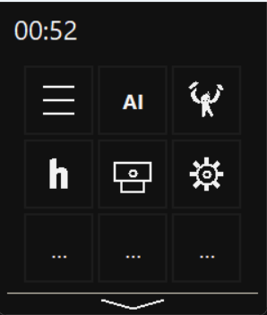
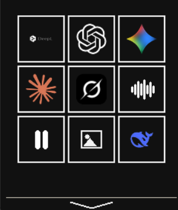
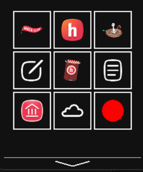
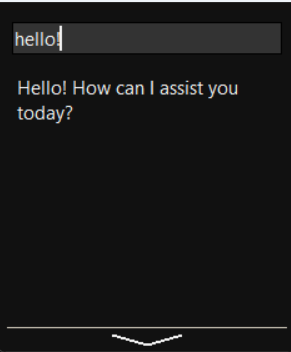

## What is it?

SmartWatchOS is Operating system for smartwatches(dauh), especially for pebble time 2 or pebble round 2
The operating system is primarily intended for people who participate in Hack Club, and it is optimized for using Hack Club from a smartwatch!
I built it because I'm crazy about OSes and I want to buy a SmartWatch, so I thought it could be cool idea!

## What's inside

What's already finished:
1: Option to use AI from the smartwatch. 9 different AI services are available!
2: Tracking Hackatime from the watch
3: Getting real-time data on your 3D printer
4: Many different Hack Club services

What's not finished yet (and will be added in Part 2):
1: A more accurate dashboard for the watch
2: More accurate weather data
3: Additional features that aren't currently included as an unfinished version on the smartwatch

## how to run

Open the project folder and run:
    python home.py
You need Python, and also tkwebview2, because the sites open inside the watch. 
It will not even open without `key.txt`, `deepl_key.txt` and `eleven_key.txt` in the folder. Those are explained below.
## screenshots

## demo

https://yonatamnyuval1-stack.github.io/SmartWatchOS/demo.html

## author

Jonathan Jacob

## license

MIT

## notes

this is part 1 of 2. the first version of the project is still in progress.